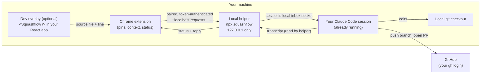

# Squashflow

Pin a comment on any website, and your own Claude Code session fixes it and opens a pull request.

Squashflow lets you hover over any live or local website and pin a comment on an element, a piece of text, a dragged area, or several elements at once. The comment, along with the page context Claude needs, is delivered to the Claude Code session you already have running in your terminal. That session fixes the code, pushes a branch and opens a pull request with your own GitHub login, then replies on the pin. There is no Squashflow server in the middle: everything except GitHub runs on your own machine.

> **Status: early development, not usable yet.**
> Nothing described here works today. This README describes the planned design so contributors and early users can see where the project is going. Commands such as `npx squashflow` are shown as they are planned to work; they do not exist yet. See the [roadmap](#roadmap) for progress.

## Contents

- [How it works](#how-it-works)
- [User flow](#user-flow)
- [Send now vs batch](#send-now-vs-batch)
- [Pin status](#pin-status)
- [Fallbacks and edge cases](#fallbacks-and-edge-cases)
- [Security model](#security-model)
- [Privacy](#privacy)
- [Requirements](#requirements)
- [Roadmap](#roadmap)
- [Comparison and credits](#comparison-and-credits)
- [Contributing](#contributing)
- [License](#license)

## How it works

Squashflow has four pieces, plus one optional piece for your own React apps.

| Piece | What it does | What you install |
| --- | --- | --- |
| **Chrome extension** | Lets you place pins on any page, captures page context (selector, text, styles, region), shows the session picker, per-pin status and reply threads, and offers a copy-to-clipboard fallback. | The extension (planned for the Chrome Web Store). |
| **Local helper** | A small process started with `npx squashflow`. It listens only on `127.0.0.1`, is paired once with your browser, lists your running Claude Code sessions, matches each session's folder to its GitHub repository, delivers pins into the session you choose, and watches the session transcript to confirm delivery and pick up Claude's reply. | Nothing permanent; runs through `npx`. |
| **Your Claude Code session** | The session you already have open in your terminal. It receives the pin, edits the code, pushes a branch and opens the pull request. | Nothing new. |
| **GitHub** | Hosts the branch and pull request. All GitHub actions use your existing `gh` login. Squashflow never stores GitHub tokens; the only secret it keeps is the local pairing token. | Nothing new, if you already use `gh`. |
| **Dev overlay** (optional) | A `<Squashflow />` component you can add to your own React app on `localhost`. It adds the source file and line number behind each element to the pin, so Claude goes straight to the right code. | An npm package in your app's dev dependencies. |



How the helper finds the right session:

1. It lists running Claude Code sessions with `claude agents --json`.
2. For each session folder it runs `git remote get-url origin` to learn which GitHub repository that session is working in.
3. When you pin a comment on a page, the extension shows the sessions that match, and you choose one (or Squashflow picks the only match).

More depth, including the planned helper endpoints, pairing, and delivery confirmation, is in [docs/architecture.md](docs/architecture.md).

## User flow

The planned flow from first-time setup to a merged pull request:

1. **Install the extension** in Chrome.
2. **Start the helper** in a terminal: `npx squashflow` (planned). It prints a short pairing code.
3. **Pair once.** Enter the code in the extension. From then on the helper accepts requests only from this paired browser.
4. **Open Claude Code** in your project folder as you normally would. The helper sees the session and matches it to the project's GitHub repository.
5. **Pin a comment.** Hover over the page, click an element (or select text, drag an area, or pick several elements) and write what you want changed.
6. **Choose the session** if more than one matches, and review the exact message that will be sent.
7. **Send.** The pin moves to *Sent*, then to *Seen by Claude* once the helper confirms the message arrived in the session.
8. **Claude fixes it.** Your session edits the code, pushes a branch and opens a pull request using your `gh` login.
9. **Reply on the pin.** Claude's reply and the pull request link appear on the pin, which moves to *Fixed*.
10. **Review and merge** the pull request on GitHub as usual, then mark the pin *Resolved*.

## Send now vs batch

| Mode | How it works | Good for |
| --- | --- | --- |
| **Send now** | Each pin is delivered to the session as soon as you send it. | A single fix, or when you want to watch each change land. |
| **Batch, then Go** | Pins collect as drafts while you review the page. When you press **Go**, they are delivered together as one message. | A review pass with many small comments that belong in one pull request. |

## Pin status

Every pin moves through a visible lifecycle:

```text
Draft ──> Sent ──> Seen by Claude ──> Fixed (reply + PR link) ──> Resolved
                │
                ├──> Approve in terminal   (Claude Code is holding the message for your approval)
                └──> Blocked               (for example, no push access to the repository)
```

## Fallbacks and edge cases

| Situation | What Squashflow does |
| --- | --- |
| No Claude Code session connected | Copy-and-paste mode: the pin is formatted as text you can paste into any session or tool. Detail levels: compact, standard, detailed, forensic. Pins are saved locally in the browser. |
| A site you do not own (for example, YouTube) | Same copy-and-paste mode. There is no repository to fix, so nothing is delivered to a session. |
| Session is in bypass-permissions mode | Claude Code holds the incoming message until you approve it in the terminal. The pin shows *Approve in terminal*. |
| No push access to the repository | The pin shows *Blocked: GitHub access* with options: log in (`gh auth login`), fork and open a pull request from the fork, copy the patch, or ask the owner. |
| Several sessions on the same repository | You pick which session receives the pin. |
| The session is busy | The message still arrives. Claude handles it between steps of its current work. |

## Security model

Squashflow is designed so that a browser extension talking to a local process cannot be turned into a way for a random website to control your coding agent. In summary:

- **No Squashflow server.** Everything except GitHub runs on your machine.
- **Localhost only.** The helper binds to `127.0.0.1`, never to `0.0.0.0` or a public interface.
- **Paired browser only.** The helper accepts requests only from the browser you paired with a short code. Every request carries the pairing token, and the helper checks the `Origin` and `Host` headers against an allowlist, which blocks cross-site request forgery and DNS rebinding from malicious pages.
- **Size limits.** Messages have a capped size.
- **You see everything that is sent.** Every outgoing message is shown to you before it is delivered.
- **Honest provenance.** A message never claims to come from somewhere it did not. Page text is placed in the message as clearly fenced data, not as instructions.
- **OS-level delivery protection.** Delivery uses a local socket that only your own OS user account can write to.
- **No GitHub token storage.** GitHub access goes through your existing `gh` login. Squashflow never stores GitHub tokens.

The full threat model, and how to report a vulnerability, is in [SECURITY.md](SECURITY.md).

## Privacy

Squashflow has no server and no telemetry. Pins, page context and replies stay on your machine, in the browser and the local helper, until you send a pin to your own Claude Code session. From there it is handled exactly like a prompt you type into that session yourself, under your own Claude Code account and settings.

Beyond that, the only thing that leaves your machine is what your Claude Code session pushes to GitHub: the branch, commits and pull request it creates with your login.

## Requirements

Planned requirements (subject to change before the first release):

- **Google Chrome** (or a Chromium-based browser that supports Chrome extensions)
- **Node.js** (current LTS) for `npx squashflow`
- **Claude Code**, minimum version to be decided
- **GitHub CLI** (`gh`), logged in with `gh auth login`
- **git**, with your project cloned locally from GitHub

## Roadmap

The planned build order. Nothing is built yet.

- [ ] 1. Helper: list sessions, match repositories, send a pin, confirm delivery
- [ ] 2. Overlay with pins and page context, plus copy-to-clipboard
- [ ] 3. Session picker
- [ ] 4. Claude replies and pin status
- [ ] 5. GitHub flow (branch, pull request, blocked-access options)
- [ ] 6. Chrome extension packaging and region screenshots

## Comparison and credits

Squashflow's pinning and annotation features are inspired by [Agentation](https://github.com/benjitaylor/agentation), an open-source tool for annotating web pages for AI coding agents. Agentation is licensed under the PolyForm Shield license. Squashflow may offer similar features, but it is written from scratch and contains no code copied from Agentation.

Where Squashflow differs is in delivery: instead of producing text you paste into an agent, it delivers pins straight into the Claude Code session you already have open and follows the work through to a pull request and a reply on the pin.

## Contributing

Contributions are welcome once the first pieces land. Read [CONTRIBUTING.md](CONTRIBUTING.md) for the branch and pull request flow, and [CODE_OF_CONDUCT.md](CODE_OF_CONDUCT.md) for community expectations. To report a security issue, follow [SECURITY.md](SECURITY.md) rather than opening a public issue.

## License

Squashflow is released under the [MIT License](LICENSE).
