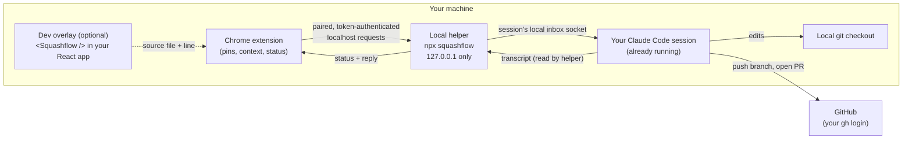

# Squashflow

Pin a comment on any website, and your own Claude Code session fixes it and opens a pull request.

Squashflow lets you hover over any live or local website and pin a comment on an element, a piece of text, a dragged area, or several elements at once. The comment, along with the page context Claude needs, is delivered to the Claude Code session you already have running in your terminal. That session fixes the code, pushes a branch and opens a pull request with your own GitHub login, then replies on the pin. There is no Squashflow server in the middle: everything except GitHub runs on your own machine.

> **Status: early development.**
> Two pieces work today. The local helper (build step 1) lists your running Claude Code sessions, matches them to GitHub repositories, delivers a pin into the session you choose and confirms it arrived. The Chrome extension places pins on any page, captures page context and copies pins to the clipboard at a chosen detail level (build step 2), pairs with the helper, lets you pick a session, previews the exact message and sends it (build step 3), shows each sent pin's status and Claude's reply, with the pull request link once it is fixed (build step 4), asks the session to open the pull request with your own `gh` login, offering a way out when it cannot (build step 5), and attaches a screenshot of each pin's region, with a packaged build ready for the Chrome Web Store (build step 6). The dev overlay is not built yet, so parts of this README still describe the planned design. Neither piece is published yet; see [Try the helper](#try-the-helper), [Install the extension](#install-the-extension) and [Try it end to end](#try-it-end-to-end) to run them from a clone. See the [roadmap](#roadmap) for progress.

## Contents

- [How it works](#how-it-works)
- [User flow](#user-flow)
- [Send now vs batch](#send-now-vs-batch)
- [Pin status](#pin-status)
- [Fallbacks and edge cases](#fallbacks-and-edge-cases)
- [Security model](#security-model)
- [Privacy](#privacy)
- [Requirements](#requirements)
- [Try the helper](#try-the-helper)
- [Install the extension](#install-the-extension)
- [Try the extension](#try-the-extension)
- [Try it end to end](#try-it-end-to-end)
- [Roadmap](#roadmap)
- [Comparison and credits](#comparison-and-credits)
- [Contributing](#contributing)
- [License](#license)

## How it works

Squashflow has four pieces, plus one optional piece for your own React apps.

| Piece | What it does | What you install |
| --- | --- | --- |
| **Chrome extension** | Lets you place pins on any page, captures page context (selector, text, styles, region), shows the session picker, per-pin status and reply threads, and offers a copy-to-clipboard fallback. | The extension (planned for the Chrome Web Store). |
| **Local helper** | A small process started with `npx squashflow`. It listens only on `127.0.0.1`, is paired once with your browser, lists your running Claude Code sessions, matches each session's folder to its GitHub repository, delivers pins into the session you choose, and watches the session transcript to confirm delivery and pick up Claude's reply. | Nothing permanent; runs through `npx`. |
| **Your Claude Code session** | The session you already have open in your terminal. It receives the pin, edits the code, pushes a branch and opens the pull request. | Nothing new. |
| **GitHub** | Hosts the branch and pull request. All GitHub actions use your existing `gh` login. Squashflow never stores GitHub tokens; the only secret it keeps is the local pairing token. | Nothing new, if you already use `gh`. |
| **Dev overlay** (optional) | A `<Squashflow />` component you can add to your own React app on `localhost`. It adds the source file and line number behind each element to the pin, so Claude goes straight to the right code. | An npm package in your app's dev dependencies. |



How the helper finds the right session:

1. It lists running Claude Code sessions from every Claude account on your machine (a work and a personal account, say, whatever their config folders are called) with `claude agents --json`, run once per account.
2. For each session folder it runs `git remote get-url origin` to learn which GitHub repository that session is working in.
3. When you pin a comment on a page, the extension shows the sessions that match, and you choose one (or Squashflow picks the only match).

More depth, including the helper endpoints, pairing, and delivery confirmation, is in [docs/architecture.md](docs/architecture.md).

## User flow

The planned flow from first-time setup to a merged pull request:

1. **Install the extension** in Chrome.
2. **Start the helper** in a terminal: `npx squashflow` (planned; for now, see [Try the helper](#try-the-helper)). It prints a short pairing code.
3. **Pair once.** Enter the code in the extension. From then on the helper accepts requests only from this paired browser.
4. **Open Claude Code** in your project folder as you normally would. The helper sees the session and matches it to the project's GitHub repository.
5. **Pin a comment.** Hover over the page, click an element (or select text, drag an area, or pick several elements) and write what you want changed.
6. **Choose the session** if more than one matches, and review the exact message that will be sent.
7. **Send.** The pin moves to *Sent*, then to *Seen by Claude* once the helper confirms the message arrived in the session.
8. **Claude fixes it.** Your session edits the code, pushes a branch and opens a pull request using your `gh` login.
9. **Reply on the pin.** Claude's reply and the pull request link appear on the pin, which moves to *Fixed* once the session reports the pull request it opened for that pin.
10. **Review and merge** the pull request on GitHub as usual, then press **Mark done** on the pin.

## Send now vs batch

| Mode | How it works | Good for |
| --- | --- | --- |
| **Send each pin** | Each pin opens its message in the side panel as soon as you save it, ready to send. | A single fix, or when you want to watch each change land. |
| **Collect, then send** (the default) | Pins wait in the side panel's *Ready to send* group while you review the page. **Send N pins to Claude** delivers them together as one message. | A review pass with many small comments that belong in one pull request. |

Choose the mode in the side panel's Settings.

## Pin status

Every pin moves through a visible lifecycle:

```text
Draft ──> Sent ──> Seen by Claude ──> Fixed (reply + PR link) ──> Resolved
                │
                ├──> Approve in terminal   (Claude Code is holding the message for your approval)
                └──> Blocked               (the session never picked the message up, or it has no GitHub access)
```

The status shows on the pin's marker (outline for a draft, violet once sent or seen, green when fixed, orange when it needs you) and in the side panel, which groups the pins by it: *Needs you* (Blocked, Approve in terminal), *Claude is on it* (Sent, Seen by Claude), *Ready to send* (drafts) and *Fixed* (Fixed, Resolved). Each pin's thread in the side panel reads like a chat: your comment, then each status change as a short line, Claude's replies as message bubbles with simple markdown (bold, italics, code, lists, `https` links) rendered safely, and your follow-ups. The message asks the session to end its reply with a `SQUASHFLOW-FIXED [<pin id>] <pull request link>` line once it has opened the pull request; only that line, for a pull request on the session's own repository, moves the pin to *Fixed* and links the pull request. A pull request link that merely appears in a reply, or a reply saying the pin landed in the wrong session, leaves the pin where it was. A batch sent together shares one reply. Press **Mark done** on a pin once you are done with it, typically after merging (it shows *Resolved*), and **Reopen** it if not.

## Fallbacks and edge cases

| Situation | What Squashflow does |
| --- | --- |
| No Claude Code session connected | Copy-and-paste mode: the pin is formatted as text you can paste into any session or tool. Detail levels: compact, standard, detailed, forensic. Pins are saved locally in the browser. |
| A site you do not own (for example, YouTube) | Same copy-and-paste mode. There is no repository to fix, so nothing is delivered to a session. |
| Session is in bypass-permissions mode | Claude Code holds the incoming message until you approve it in the terminal. The pin shows *Approve in terminal*. |
| No push access to the repository | The pin shows *Blocked: GitHub access* with the session's reason and four options: log in (`gh auth login`, then retry), fork and open a pull request from the fork, copy the patch, or ask the owner. See [When GitHub says no](#when-github-says-no). |
| Several sessions on the same repository | You pick which session receives the pin. |
| The session is busy | The message still arrives. Claude handles it between steps of its current work. |

## Security model

Squashflow is designed so that a browser extension talking to a local process cannot be turned into a way for a random website to control your coding agent. In summary:

- **No Squashflow server.** Everything except GitHub runs on your machine.
- **Localhost only.** The helper binds to `127.0.0.1`, never to `0.0.0.0` or a public interface.
- **Paired browser only.** The helper accepts requests only from the browser you paired with a short code. Every request carries the pairing token, and the helper checks the `Origin` and `Host` headers against an allowlist, which blocks cross-site request forgery and DNS rebinding from malicious pages.
- **Size limits.** Messages have a capped size.
- **You see everything that is sent.** Every outgoing message is shown to you before it is delivered.
- **Honest provenance.** A message never claims to come from somewhere it did not. Page text is placed in the message as clearly fenced data, not as instructions.
- **OS-level delivery protection.** Delivery uses a local socket that only your own OS user account can write to.
- **No GitHub token storage.** GitHub access goes through your existing `gh` login. Squashflow never stores GitHub tokens.

The full threat model, and how to report a vulnerability, is in [SECURITY.md](SECURITY.md).

## Privacy

Squashflow has no server and no telemetry. Pins, page context and replies stay on your machine, in the browser and the local helper, until you send a pin to your own Claude Code session. From there it is handled exactly like a prompt you type into that session yourself, under your own Claude Code account and settings.

Beyond that, the only thing that leaves your machine is what your Claude Code session pushes to GitHub: the branch, commits and pull request it creates with your login.

## Requirements

Requirements (subject to change before the first release):

- **Google Chrome** (or a Chromium-based browser that supports Chrome extensions)
- **Node.js** 22.12 or later for the helper (current LTS recommended)
- **Claude Code** 2.1.224 or later, macOS or Linux (`squashflow doctor` checks this)
- **GitHub CLI** (`gh`), logged in with `gh auth login`
- **git**, with your project cloned locally from GitHub

## Try the helper

The helper can already deliver a pin into a running Claude Code session from the command line, without the extension. It is not on npm yet, so build it from a clone (development needs Node.js 22.12 or later and pnpm through Corepack):

```sh
git clone https://github.com/Uchiha-Itachi0/squashflow.git
cd squashflow
corepack pnpm install
corepack pnpm build
alias squashflow="node $PWD/packages/helper/dist/cli.js"
```

Then, with a Claude Code session open in one of your projects:

```sh
squashflow doctor                 # checks Node, Claude Code version, git and the session inbox
squashflow sessions               # lists running sessions with their title, terminal, account, branch, status and GitHub repository
squashflow send --session <name or pid> "Make the Buy button on /pricing blue"
```

To check the helper the way it will be published, `corepack pnpm check:pack` packs it with `pnpm pack` and runs `npx squashflow --version` from the tarball in an empty folder (it publishes nothing).

`send` prints the exact message that will be delivered and asks `Send this message? [y/N]`. After you confirm, it delivers the message to that session and waits until the session's transcript shows it arrived:

```text
squish → claude@my-app  pin 1  Sent
(｡>ᴗ<｡) squashed! pin 1 seen by Claude
```

If the session runs in bypass-permissions mode, Claude Code holds the message and the helper prints *approve it in the terminal*; approve it in that session's terminal and the pin moves on to *seen by Claude*. The message arrives as a request from another session, never as your own typing, and Claude Code's permissions still apply.

The helper finds every account's sessions from their inbox sockets and their own environment. If an account's sessions do not show up, list its config folder in `SQUASHFLOW_CLAUDE_CONFIG_DIRS` (separated like `PATH`) before starting the helper, for example `SQUASHFLOW_CLAUDE_CONFIG_DIRS=~/.claude-personal squashflow`.

`squashflow` on its own starts the helper's local server on `http://127.0.0.1:47821` and prints a pairing code for the extension (see [Try the extension](#try-the-extension)). Add `--no-color`, or set `NO_COLOR`, for plain output.

## Install the extension

The extension is not in the Chrome Web Store yet. Install it unpacked, either from the package CI builds or from your own clone.

**From the store package.** Every CI run builds the exact zip that will go to the Chrome Web Store and keeps it for 30 days: open a run of the CI workflow on GitHub and download the `squashflow-extension` artifact, or build it yourself (see [Try the helper](#try-the-helper) for the clone and install steps):

```sh
corepack pnpm package     # writes packages/extension/build/squashflow-<version>.zip and prints its SHA-256
```

Chrome does not install a zip directly, so unzip it into a folder of its own (`unzip squashflow-0.1.0.zip -d squashflow`). The build is reproducible: the same commit always gives a zip with the same SHA-256.

**From a clone.** `corepack pnpm build` writes the unpacked extension to `packages/extension/build/chrome-mv3-prod`.

Then load it:

1. Open `chrome://extensions` and turn on **Developer mode**.
2. Click **Load unpacked** and choose the unzipped folder, or `packages/extension/build/chrome-mv3-prod`.
3. Pin Squashflow to the toolbar if you like.

The store listing text, permission justifications, privacy statement and screenshots live in [`packages/extension/store`](packages/extension/store/listing.md), next to the code they describe.

## Try the extension

On any `http` or `https` page, click the Squashflow button or press **Alt+Shift+P** (change the shortcut at `chrome://extensions/shortcuts`). That opens the Squashflow side panel next to the page and turns pin mode on for that page. The page itself shows only a small dark toolbar at the bottom, the pins' numbered markers, and a comment box next to the pin you are placing; everything else is in the side panel.

The toolbar picks how you pin, and while pin mode is on, clicks place pins instead of reaching the page:

- **Element:** click an element to pin it (dragging pins an area, and Shift+click picks several).
- **Text:** select text to pin the selection.
- **Area:** drag a box around what you want to pin.
- **Multi:** click several elements, then press **Pin N selected** (or Enter) to pin them together.

It also has a close button; sending, copying and the session are all in the side panel. Each pin gets a numbered marker and a screenshot of the pinned region of the tab (taken with Squashflow's own UI hidden); untick **Attach a screenshot** in the comment box to save the pin without it. Click a marker to open that pin in the side panel. Press **Escape** to close the comment box, and again to leave pin mode; the side panel's **Start pinning on this page** turns it back on. Pins are kept in the extension's local storage, per page, until you delete them.

The side panel is an inbox of the page's pins, each one a chat with Claude, grouped by who acts next: **Needs you**, **Claude is on it**, **Ready to send** and **Fixed**. Its header shows who fixes this site (the chosen session; click it to choose another) and a Settings button. Open a pin to see its chat: your comment with its screenshot, then each status change as a small grey line, Claude's replies, and a box to reply to Claude. Copy, Details (the page, element, selected text and screen size that were pinned) and Delete or Mark done are quiet links under it; a draft can also be edited and sent from there.

**Settings** holds the connection (**Connect again**, **Disconnect**, and the port), how pins are sent, copying by hand, how much a copy includes (**Short**, **Normal**, **Full**, or **+ Screenshot**, which adds the screenshot), and stopping pin mode on the page.

To send pins straight to a session instead of pasting them:

1. Start the helper with `squashflow` (see [Try the helper](#try-the-helper)). It prints a pairing code.
2. In the side panel, type the code and press **Connect** (if you started the helper with `--port`, set the port in Settings first). You connect once; a green line confirms it.
3. Pick the session in the sheet that opens (later, click the session chip in the header). Sessions from all your Claude accounts are listed. Each card shows the session's name (Claude Code's own title for it, else its terminal workspace's name such as `~vma`, else its folder) with the terminal workspace beside it, and under it the account, repository and branch, and whether it is ready or busy, with when it was last active:

```text
Refill new VMA index                     ~vma
ideonlabs.com · ideon-labs/vma · main
Busy. Reads pins between steps. · 2m ago
```

Nothing is chosen for you unless exactly one session is on the repository remembered for this site (being the only session running, or your pick on another site, does not count); sessions on that repository are marked **This site**. Tick **Remember: this site's code is `owner/repo`** and next time that session is chosen for you on this site, as long as it is the only one on that repository. **refresh** picks up sessions you started since. Press **Use `<session>`**; a green line confirms who will fix the site.
4. With **Collect, then send** (the default), pins wait in *Ready to send*; press **Send N pins to Claude** in the side panel to send them all. With **Send each pin**, each pin's message opens as you save it. Either way the side panel first shows the exact message the session will receive; press **Send N pins to Claude** to deliver it, or **Cancel**. The panel then says it was sent, or why not in plain words (for example, the preview expired and needs previewing again).

After sending, each pin shows its [status](#pin-status) on its marker and in the side panel: *Sent*, *Seen by Claude* or *Approve in terminal*, then *Fixed* with Claude's reply and the pull request link. Not quite right? Type a reply in the pin's conversation: it goes to the same session as a follow-up about the same element, previewed and confirmed like a pin, and the pin follows it from *Sent* again. Press **Mark done** on a pin when you are done with it, or **Reopen** to undo that. The helper follows a pin until Claude replies; if the session's transcript goes quiet for 30 minutes before the pin is picked up (for example, the session exited), the pin shows *Blocked*. Status and replies arrive while the side panel or pin mode is open, and catch up the next time you open it.

To copy instead, press **Copy all** in the side panel, a pin's **Copy**, or **Skip. I'll copy pins by hand.** when it asks you to connect: copying by hand never sends anything, and works with nothing connected. Paste the text into your Claude Code session. With **+ Screenshot**, one pin's screenshot goes on the clipboard as an image along with the text (paste it into Claude Code with Ctrl+V); with several, the text says to use each pin's **Copy screenshot**. If the helper is not running, you have not paired, or no session is open on the site's repository, the side panel says so and Copy still works.

### When GitHub says no

Every message asks the session to commit the fix on a new branch, push it and open a pull request with `gh pr create`, all with your own `git` and `gh` login; Squashflow never sees a GitHub token. If the push or the pull request fails because you lack access, the session stops instead of retrying and replies with a fixed line, `SQUASHFLOW-BLOCKED [sf-…] github-access: <reason>`, which moves the pin to *Blocked: GitHub access* and into the inbox's **Needs you** group. The pin's chat then ends with a dark *Needs you* card, *Claude fixed it but can't push to GitHub.*, whose button is the best way out, with the others as links:

- **Open a PR from my fork** (the button): sends a follow-up asking the session to fork the repository and open the pull request from the fork.
- **use another account:** shows `gh auth login` to run in a terminal, then **Retry**, which sends the session a follow-up to push and open the pull request again.
- **copy the change:** copies the diff from Claude's reply. If no reply has one yet, it first sends a follow-up asking the session for it; press it again once Claude replies.
- **ask the owner:** copies a ready-made message for the repository owner, with your comment and Claude's summary of the change.

Follow-ups go to the session that has the pin and, like pins, are shown in full and sent only when you press **Send to Claude**.

The extension asks for as little as it can:

| Permission | Why |
| --- | --- |
| `activeTab` | Lets the extension act on the current tab only, and only after you click its button or press its shortcut. The same grant lets it screenshot that tab's visible area for a pin's region screenshot. There are no host permissions: it cannot read or change any site on its own. |
| `scripting` | Injects the pin mode script into that tab when you turn pin mode on. Nothing is injected into pages you have not asked for. |
| `sidePanel` | Shows Squashflow's panel (your pins and their conversations, the sessions, the settings) in Chrome's side panel next to the page, instead of on top of the page. It opens when you click the toolbar button. It gives no access to any page. |
| `storage` | Keeps your pins, their screenshots, their status and Claude's replies, and the sites whose repository you asked it to remember, in the extension's local storage, which web pages cannot read. |
| `unlimitedStorage` | Region screenshots are kept with their pins (up to 200 KB each). Without this, local storage stops at 10 MB, and saving pins would start failing after a few dozen screenshots. It adds no install warning and gives no access to anything else. |

There is no remote code: everything the extension runs ships inside it, including its fonts (Geist, Geist Mono and Newsreader, under the SIL Open Font License). Talking to the helper needs no extra permission: only the extension's background service worker calls it, on `127.0.0.1`, at the side panel's request, and the helper answers only the paired extension's origin. The pairing token stays in that service worker's own storage, out of reach of web pages, of the script running in the page, and of the side panel. The script in the page cannot ask the helper anything at all. It never captures the values of form fields (including password and hidden fields) as text, and every captured field is size-capped; a region screenshot does show whatever is on screen in that region, so untick **Attach a screenshot** when it holds something private; the details are in [docs/architecture.md](docs/architecture.md#the-extension). The toolbar and comment box run inside the page, so a page's own scripts can see what you type into a comment box, as they can with any in-page tool; replies to Claude are typed in the side panel, which pages cannot see.

## Try it end to end

With a clone built (`corepack pnpm install && corepack pnpm build`) and the extension loaded:

1. **Start the helper** in a terminal: `node packages/helper/dist/cli.js` (or the `squashflow` alias from [Try the helper](#try-the-helper)). It prints a pairing code.
2. **Open Claude Code** in a clone of a GitHub repository you can push to, as you normally would.
3. **Open a page of that project** (a local dev server or the live site) and press **Alt+Shift+P**. The side panel opens next to the page.
4. **Connect** in the side panel with the code from step 1, pick your session, and tick **Remember: this site's code is `owner/repo`**.
5. **Pin something**: pick **Area** on the toolbar, drag around what should change and write what you want, for example "make this heading smaller". Keep **Attach a screenshot** ticked and press **Save pin**.
6. **Send 1 pin to Claude.** The preview shows the exact message, including the screenshot's file path under `~/.squashflow/screenshots/` and its SHA-256; press **Send 1 pin to Claude** again to deliver it.
7. **Watch the pin's chat**: *Sent*, then *Seen by Claude* (or *Approve in terminal* in a bypass-permissions session; approve it there), then Claude's reply. Claude may ask to read the screenshot file, which is outside the project folder; allow it.
8. **Review the pull request** linked in the chat once the pin shows *Fixed*, then **Mark done**, or reply to Claude if it is not right yet.

## Roadmap

The planned build order.

- [x] 1. Helper: list sessions, match repositories, send a pin, confirm delivery
- [x] 2. Pins and page context in the browser, plus copy-to-clipboard
- [x] 3. Session picker
- [x] 4. Claude replies and pin status
- [x] 5. GitHub flow (branch, pull request, blocked-access options)
- [x] 6. Chrome extension packaging and region screenshots

## Comparison and credits

Squashflow's pinning and annotation features are inspired by [Agentation](https://github.com/benjitaylor/agentation), an open-source tool for annotating web pages for AI coding agents. Agentation is licensed under the PolyForm Shield license. Squashflow may offer similar features, but it is written from scratch and contains no code copied from Agentation.

Where Squashflow differs is in delivery: instead of producing text you paste into an agent, it delivers pins straight into the Claude Code session you already have open and follows the work through to a pull request and a reply on the pin.

## Contributing

Contributions are welcome once the first pieces land. Read [CONTRIBUTING.md](CONTRIBUTING.md) for the branch and pull request flow, and [CODE_OF_CONDUCT.md](CODE_OF_CONDUCT.md) for community expectations. To report a security issue, follow [SECURITY.md](SECURITY.md) rather than opening a public issue.

## License

Squashflow is released under the [MIT License](LICENSE).
