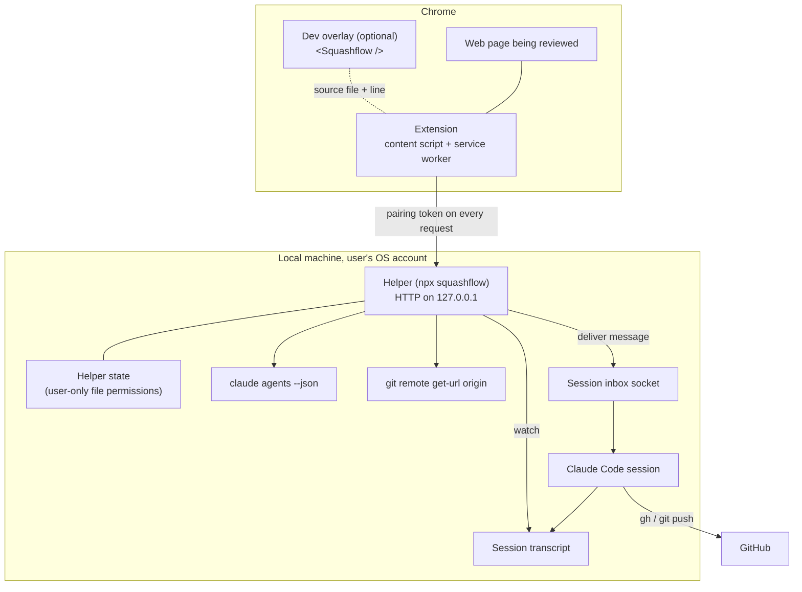

# Squashflow architecture

> **Planned design.** Nothing here is implemented yet. This document records the architecture and security decisions Squashflow is being built against. Names, endpoints and formats are expected to change as the code lands; when they do, this document is updated in the same pull request.

For a shorter overview, see the [README](../README.md). For the threat model and vulnerability reporting, see [SECURITY.md](../SECURITY.md).

## Goals and constraints

- **Local-first.** No Squashflow server. Everything except GitHub runs on the user's machine.
- **Use what the user already has.** The user's existing Claude Code session does the work, and the user's existing `gh` login does the GitHub work. Squashflow adds no accounts and stores no tokens.
- **The user stays in control.** Every outgoing message is shown before it is delivered, and Claude Code's own permission model is never bypassed.
- **Fail useful.** When delivery is impossible (no session, a site the user does not own, no push access), Squashflow falls back to something the user can still act on.

## Components



| Component | Responsibility |
| --- | --- |
| Extension | Pin placement (element, text selection, dragged area, multiple elements), page context capture, session picker, message preview, per-pin status and threads, local pin storage, copy fallback. |
| Helper | Pairing, session discovery, repository matching, message delivery, delivery confirmation, reply pickup, status events. |
| Claude Code session | Reads the pin, edits code, pushes a branch, opens a pull request, replies. |
| GitHub | Hosts the branch and pull request, reached only through the session's `gh` and `git`. |
| Dev overlay | In the user's own React app on `localhost`, exposes the source file and line behind each element so the extension can include it in the pin. |

## The local helper

### Process and network

- Started with `npx squashflow`. It runs in the foreground in a terminal so the user can see it and stop it.
- Binds an HTTP server to `127.0.0.1` on a fixed default port, configurable. It never binds `0.0.0.0`, `::` or a LAN address.
- Has no outbound network access of its own beyond what `claude`, `git` and `gh` do when it runs them.

### Endpoints (planned)

All endpoints except pairing require the pairing token. All responses are JSON. Request bodies are size-capped.

| Method and path | Purpose |
| --- | --- |
| `POST /pair` | Exchange the pairing code shown in the terminal for a pairing token. |
| `GET /health` | Report that the helper is running and paired, plus its version. |
| `GET /sessions` | List running Claude Code sessions with their folder and matched GitHub repository. |
| `POST /pins` | Deliver one pin, or a batch, to a chosen session. Returns a delivery id. |
| `GET /pins/{id}` | Current status of a delivered pin. |
| `GET /events` | Server-sent events stream of status changes and replies for the paired browser. |

### Request checks

Every request is checked in this order, and rejected on the first failure:

1. **Host.** The `Host` header must be exactly `127.0.0.1:<port>` or `localhost:<port>`. This defeats DNS rebinding, where a hostile domain is made to resolve to `127.0.0.1` but the browser still sends that domain in `Host`.
2. **Origin.** The `Origin` header must be the extension's own `chrome-extension://<id>` origin. Requests from web page origins, or with no `Origin` on state-changing methods, are rejected.
3. **Size.** The body must be within the configured limit before it is read in full.
4. **Token.** The `Authorization` header must carry the current pairing token, compared in constant time.
5. **Schema.** The body must validate against the endpoint's schema. Unknown fields are rejected.

CORS responses name only the paired extension origin, never `*`.

## Pairing

1. On start, if there is no paired browser, the helper prints a short random pairing code in the terminal.
2. The user enters the code in the extension, which sends it to `POST /pair`.
3. The helper checks the code, then returns a random, high-entropy pairing token and records the extension origin.
4. The extension keeps the token in extension storage, which web pages cannot read.

Pairing codes are single-use, expire after a short time, and allow a small number of attempts before a new code is required. Re-pairing replaces the old token, which is how a user revokes a browser.

## Session discovery and repository matching

1. The helper runs `claude agents --json` to list running Claude Code sessions and their working folders.
2. For each folder it runs `git remote get-url origin` and normalises the result (SSH or HTTPS) to an `owner/repo` name.
3. For the page being reviewed, the extension asks for sessions. Matching uses the repository a page is known to belong to: the dev overlay reports it directly for local apps, and for live sites the user picks or remembers a site-to-repository mapping.
4. If exactly one session matches, it is preselected. If several match, the user picks. If none match, the copy fallback is offered.

Commands are run with fixed argument lists, never through a shell, and with the session folder as the working directory.

## Building the message

A message delivered to a session has a fixed structure:

1. **Provenance header.** States that this is a Squashflow pin from the browser, with the page URL. It never claims to be typed by the user in the terminal or to come from anywhere else.
2. **The user's comment.** The only instructions in the message.
3. **Page context, fenced as data.** Selectors, element text, attributes, computed styles, source file and line (from the dev overlay), and region screenshots, inside a clearly delimited block labelled as untrusted page content.
4. **Requested outcome.** Fix the issue on a new branch, open a pull request, and reply with a summary and the link.

The extension renders this exact message in a preview before sending. The helper delivers the previewed message unchanged; if the content changes, it must be previewed again. Batches are one message containing several numbered pins.

## Delivery and confirmation

1. The helper writes the message to the chosen session's local inbox socket. The socket is owned by, and writable only by, the user's OS account; the helper refuses a socket with unexpected ownership or permissions.
2. The pin moves to **Sent**.
3. The helper watches the session's transcript. When the message appears in it, the pin moves to **Seen by Claude**.
4. If Claude Code is holding the message for approval (for example, in bypass-permissions mode), the pin moves to **Approve in terminal** until the user approves it there.
5. If the session is busy, the message is queued by Claude Code and handled between steps; the pin stays **Sent** until it appears in the transcript.
6. When Claude replies, the helper picks the reply out of the transcript and sends it to the extension as a thread message. A reply that includes a pull request link moves the pin to **Fixed**.
7. The user marks the pin **Resolved**, typically after merging.

```text
Draft ──> Sent ──> Seen by Claude ──> Fixed (reply + PR link) ──> Resolved
                │
                ├──> Approve in terminal
                └──> Blocked
```

## GitHub flow

- The session creates a branch, commits, pushes and opens a pull request with the user's own `gh` login and git credentials. Squashflow never sees or stores a token.
- If the push or pull request fails because the user lacks access, the pin moves to **Blocked: GitHub access** with these options:
  - **Log in:** run `gh auth login` and retry.
  - **Fork and open a PR:** the session forks the repository and opens the pull request from the fork.
  - **Copy the patch:** copy the diff to the clipboard to share another way.
  - **Ask the owner:** copy a ready-made message describing the change for the repository owner.

## Fallbacks

| Situation | Behaviour |
| --- | --- |
| Helper not running or not paired | Copy-and-paste mode. Pins are saved locally in the browser. |
| No matching session | Copy-and-paste mode, or the user starts a session and refreshes the picker. |
| Site the user does not own | Copy-and-paste mode with detail levels: compact, standard, detailed, forensic. |
| Bypass-permissions session | Claude Code holds the message; pin shows **Approve in terminal**. |
| Several sessions on one repository | The user picks. |
| Busy session | Message is delivered and handled between steps. |
| No push access | **Blocked: GitHub access** with the options above. |

Copy detail levels:

| Level | Contents |
| --- | --- |
| Compact | Comment and element selector. |
| Standard | Adds page URL, element text and key attributes. |
| Detailed | Adds computed styles, surrounding structure and source location when available. |
| Forensic | Adds full context, including region screenshots and every captured attribute. |

## Dev overlay

`<Squashflow />` is an optional component for the user's own React app, rendered only in development. It maps DOM elements back to the source file and line that rendered them and makes that available to the extension on the page, so pins on a local app point Claude straight at the code. It does not hold the pairing token and does not talk to the helper directly. It is never meant to ship in a production build.

## Local data

- Helper state (pairing token hash, extension origin, settings) is stored in a file readable and writable only by the user.
- Pins and threads are stored in the extension's local storage.
- Nothing is sent to a Squashflow server, because there is none, and there is no telemetry.

## Build order

1. Helper: list sessions, match repositories, send, confirm.
2. Overlay with pins and context, plus copy.
3. Session picker.
4. Claude replies and pin status.
5. GitHub flow.
6. Chrome extension packaging and region screenshots.

## Open questions

- The minimum Claude Code version, which depends on the session inbox and `claude agents --json` interfaces the helper relies on.
- How live sites are mapped to repositories when there is no dev overlay.
- How region screenshots are stored and passed to the session.
