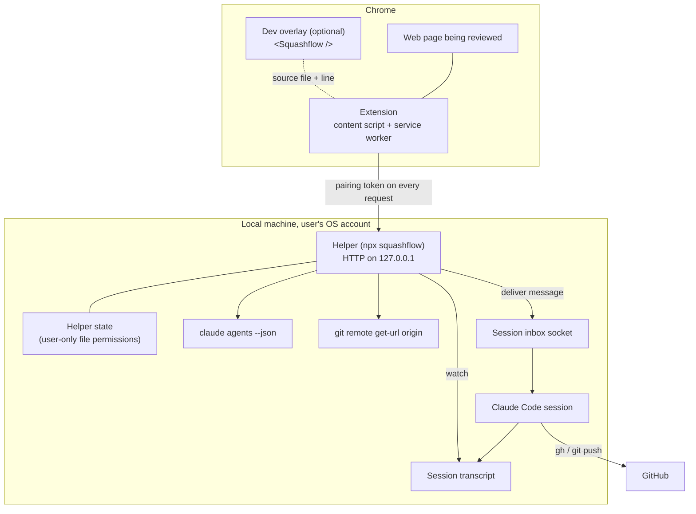

# Squashflow architecture

> **Partly implemented.** The local helper (build step 1) is implemented in [`packages/helper`](../packages/helper), and the extension's pins, page context and copy (build step 2) and its pairing, session picker and sending (build step 3) in [`packages/extension`](../packages/extension), with the message builder and the helper's API schemas they share in [`packages/shared`](../packages/shared). The sections on the helper, pairing, discovery, the message, delivery, the extension, sending and copy describe what the code does today. Everything else (per-pin status in the browser, replies, dev overlay, GitHub flow) is still the planned design. When names, endpoints or formats change, this document is updated in the same pull request.

For a shorter overview, see the [README](../README.md). For the threat model and vulnerability reporting, see [SECURITY.md](../SECURITY.md).

## Goals and constraints

- **Local-first.** No Squashflow server. Everything except GitHub runs on the user's machine.
- **Use what the user already has.** The user's existing Claude Code session does the work, and the user's existing `gh` login does the GitHub work. Squashflow adds no accounts and stores no GitHub tokens or other third-party credentials; the only secret it keeps is the local pairing token.
- **The user stays in control.** Every outgoing message is shown before it is delivered, and Claude Code's own permission model is never bypassed.
- **Fail useful.** When delivery is impossible (no session, a site the user does not own, no push access), Squashflow falls back to something the user can still act on.

## Components



| Component | Responsibility |
| --- | --- |
| Extension | Pin placement (element, text selection, dragged area, multiple elements), page context capture, session picker, message preview, per-pin status and threads, local pin storage, copy fallback. |
| Helper | Pairing, session discovery, repository matching, message delivery, delivery confirmation, reply pickup, status events. |
| Claude Code session | Reads the pin, edits code, pushes a branch, opens a pull request, replies. |
| GitHub | Hosts the branch and pull request, reached only through the session's `gh` and `git`. |
| Dev overlay | In the user's own React app on `localhost`, exposes the source file and line behind each element so the extension can include it in the pin. |

## The local helper

### Process and network

- Started with `npx squashflow` (or `squashflow start`). It runs in the foreground in a terminal so the user can see it and stop it with Ctrl+C. It is not published to npm yet; until then it runs from a clone (see the README).
- Binds an HTTP server to `127.0.0.1` on port **47821** by default, changeable with `--port`. It refuses to bind anything else: not `0.0.0.0`, `::`, `localhost` or a LAN address.
- Has no outbound network access of its own beyond what `claude`, `git` and `gh` do when it runs them.
- Requires macOS or Linux. On Windows it prints that Windows is not supported yet and exits.

### Endpoints

All endpoints except pairing require the pairing token as `Authorization: Bearer <token>`. All responses are JSON except the event stream. Request bodies are capped at 64 KiB.

| Method and path | Purpose |
| --- | --- |
| `POST /pair` | Exchange the pairing code shown in the terminal for a pairing token. Body: `{"code"}`. |
| `GET /health` | Report that the helper is running and paired, plus its version. |
| `GET /sessions` | List running Claude Code sessions: `pid`, `name`, `status`, `cwd` and the matched repository (`owner/repo`, or `null`). |
| `POST /pins` | Preview, then deliver, one pin or a batch to a chosen session. See [Building the message](#building-the-message). |
| `GET /pins/{id}` | Current status of a delivered pin. |
| `GET /events` | Server-sent events stream (`event: pin`) of status changes for the paired browser. Browsers' `EventSource` cannot send an `Authorization` header, so the extension reads it with a streaming `fetch`. |

### Request checks

Every request is checked in this order, and rejected on the first failure:

1. **Host.** The `Host` header must be exactly `127.0.0.1:<port>`. This defeats DNS rebinding, where a hostile domain is made to resolve to `127.0.0.1` but the browser still sends that domain in `Host`. Failure: `403`.
2. **Origin.** The `Origin` header, when present, must be the paired extension's `chrome-extension://<id>` origin; for `POST /pair` it must be some `chrome-extension://<32-letter id>` origin, which is then recorded. Requests from web page origins, or with no `Origin` on state-changing methods, are rejected. Failure: `403`.
3. **Size.** A declared `Content-Length` above 64 KiB is rejected before anything is read, and a body without a declared length is cut off as soon as it passes the cap. Failure: `413`.
4. **Token.** The bearer token's SHA-256 is compared in constant time with the stored hash. Failure: `401`.
5. **Schema.** The body must be JSON and validate against the endpoint's schema. Every object is strict: unknown fields are rejected, at the top level and nested. Failure: `400`.

CORS responses name only the paired extension origin, never `*`.

## Pairing

1. On start, if there is no paired browser (or with `--pair`), the helper prints a pairing code in the terminal, such as `BGV9-7X3Y`. Pressing Enter in the helper's terminal prints a fresh code.
2. The user enters the code in the extension, which sends it to `POST /pair`.
3. The helper checks the code, then returns a random pairing token (32 bytes, base64url) and records the extension origin.
4. The extension keeps the token, with the helper's port, in the service worker's IndexedDB. That database belongs to the extension's own origin: web pages cannot read it, and neither can the pin mode script, which runs in the page's origin (unlike `chrome.storage.local`, which the pin mode script could read). Only the service worker calls the helper.

Pairing codes are 8 characters from an alphabet without look-alike characters, single-use, expire after **5 minutes**, and allow **5 attempts**; after that the code is void and a new one must be printed in the terminal. Re-pairing replaces the old token, which is how a user revokes a browser.

The helper stores only the SHA-256 hash of the token, with the paired origin, in `~/.squashflow/state.json` (or under `$SQUASHFLOW_HOME`). The directory is mode `0700` and the file `0600`.

## Session discovery and repository matching

1. The helper runs `claude agents --json`, which lists running sessions with `pid`, `cwd`, `name`, `status` (`idle` or `busy`) and `sessionId`.
2. For each folder it runs `git remote get-url origin` and normalises the result (SSH, `scp`-style, HTTPS or `git://`) to an `owner/repo` name. Remotes on other hosts keep the host, as `host/owner/repo`; anything else counts as no repository.
3. For the page being reviewed, the extension asks for sessions. Matching uses the repository a page is known to belong to. Today that is the site-to-repository mapping the user chose to remember for the page's origin; the dev overlay will report it directly for local apps once it exists. Repository names are compared case-insensitively.
4. If exactly one session matches, it is preselected. If several match, the user picks. If none match, or no repository is known for the site, the user picks any session or copies the pins instead.

Commands are run with `execFile` and fixed argument lists, never through a shell, with the session folder as the working directory and a timeout.

## Building the message

A message delivered to a session has a fixed structure:

1. **Provenance header.** States that this is Squashflow pin `[sf-<12 hex>]` from the user's browser, delivered by the local helper, not typed in the terminal, with the page URL. Pins sent with `squashflow send` say so instead. It never claims to be typed by the user in the terminal or to come from anywhere else.
2. **The user's comment.** The only instructions in the message. Batches number the comments.
3. **Page context, fenced as data.** Selectors, element text, attributes, computed styles and source file and line (from the dev overlay), as JSON inside `<untrusted-page-context>` with a line telling Claude it is untrusted data and not to follow instructions in it. Every `<`, `>` and `&` in the JSON is escaped, so page content can never close the fence or the surrounding wrapper. Region screenshots are not supported yet.
4. **Requested outcome.** Fix the issue on a new branch, open a pull request, and reply with a summary and the link.

The builder lives in `@squashflow/shared` and is used by both the helper (delivery) and the extension (copy), so both produce the same structure, fencing and escaping. A copied message states its provenance as copied from the user's browser and pasted by the user, and is filtered to the chosen [copy detail level](#fallbacks); a delivered message carries the context exactly as the extension sent it.

The previewed message is the delivered message:

1. `POST /pins` with `"preview": true` builds the message and returns it with its `pinId` and SHA-256 `digest`, without delivering anything.
2. The extension shows that exact message. To send it, it repeats the request with the `pinId` and `digest` instead of `preview`.
3. The helper rebuilds the message from the request and delivers it only if it hashes to the previewed digest, the preview is unused and less than 10 minutes old, and the session is the same. Otherwise the user must preview again.

`squashflow send` uses the same path: it prints the message, asks `Send this message? [y/N]`, and delivers only on `y`.

## Delivery and confirmation

1. The helper wraps the message as `<cross-session-message from="uds:<helper socket>" from-name="squashflow">…</cross-session-message>` and writes it as one NDJSON line, `{"type":"user","message":{"role":"user","content":…}}`, to the session's inbox socket at `/tmp/cc-socks/<pid>.sock` (`$SQUASHFLOW_INBOX_SOCKET_DIR` overrides the folder, which the browser test uses to deliver to a fake inbox). The helper socket named in `from` is a real socket it listens on, `/tmp/squashflow-<uid>/helper-<pid>.sock` (a short per-user path, so it never contains spaces). The session shows it as "Message from @squashflow" and treats it as a request from another session, never as the user's own typing; Claude Code's permissions still apply.
2. Before writing, the helper checks the inbox path with `lstat` and refuses anything that is not a socket, is not owned by the current user, or is not mode `0600`. A symlink is refused, not followed. `--bare` sessions have no inbox socket and cannot receive pins.
3. The pin moves to **Sent**.
4. The socket sends no acknowledgement, so the helper watches the session's transcript, `<config>/projects/<cwd with every non-alphanumeric character as ->/<sessionId>.jsonl`, where `<config>` is `$CLAUDE_CONFIG_DIR` or `~/.claude`. It reads only lines appended after delivery and matches them on the pin id. It stops watching once the pin is Seen by Claude, or after 30 minutes (for example when the session exited or the held message was rejected).
5. When a `user` record with a peer origin carrying the pin id appears, the pin moves to **Seen by Claude**.
6. If Claude Code is holding the message for approval (a session in bypass-permissions mode records a "Held peer message" notice), the pin moves to **Approve in terminal** until the user approves it there, then to **Seen by Claude**.
7. If the session is busy, Claude Code queues the message and handles it between steps; the pin stays **Sent** until it appears in the transcript.
8. When Claude replies, the helper picks the reply out of the transcript and sends it to the extension as a thread message. A reply that includes a pull request link moves the pin to **Fixed**. (Planned.)
9. The user marks the pin **Resolved**, typically after merging. (Planned.)

```text
Draft ──> Sent ──> Seen by Claude ──> Fixed (reply + PR link) ──> Resolved
                │
                ├──> Approve in terminal
                └──> Blocked
```

## GitHub flow

- The session creates a branch, commits, pushes and opens a pull request with the user's own `gh` login and git credentials. Squashflow never sees or stores a GitHub token.
- If the push or pull request fails because the user lacks access, the pin moves to **Blocked: GitHub access** with these options:
  - **Log in:** run `gh auth login` and retry.
  - **Fork and open a PR:** the session forks the repository and opens the pull request from the fork.
  - **Copy the patch:** copy the diff to the clipboard to share another way.
  - **Ask the owner:** copy a ready-made message describing the change for the repository owner.

## The extension

A Manifest V3 Chrome extension built with Plasmo, in TypeScript.

### Permissions and injection

The manifest asks for `activeTab`, `scripting` and `storage`, and nothing else: no host permissions, no declared content scripts, no remote code. Calls to the helper need no host permission either: the service worker's requests to `http://127.0.0.1:<port>` are cross-origin requests carrying the extension's `chrome-extension://<id>` origin, which the helper answers with CORS headers naming that origin only. Clicking the toolbar button (or the `Alt+Shift+P` shortcut, which triggers the same action) grants `activeTab` for that tab, and the service worker injects the pin mode script into it with `chrome.scripting.executeScript`. Pages other than `http` and `https`, and pages the browser protects, are refused with a badge on the button. Each injection toggles pin mode: the script's isolated world keeps the running instance between injections on the same page.

### Pin mode

While pin mode is on, the extension listens in the capture phase and stops the page from seeing clicks, so the page does not react:

| Pin | How |
| --- | --- |
| Element | Click it. |
| Dragged area | Press and drag more than 6 px. The pin records the area, the elements wholly inside it, and the deepest element enclosing them. |
| Several elements | Shift+click each one, then release Shift. |
| Text selection | Switch the panel to Text and select text. The pin records the selected text and the element holding it. |

A new pin opens a comment box; the pin is saved only when the comment is. Each pin gets a numbered marker, placed on its element if the selector still finds it and otherwise where it was captured. Escape closes the comment box or the message preview, then clears a Shift selection, then leaves pin mode.

All of the UI lives in a shadow root on a `<squashflow-root>` element appended to `<html>`. Its styles live inside the shadow root, so they never reach the page, and `all: initial !important` on the host stops inherited page styles, including a page's `!important` rules, from reaching in. Keys typed in the UI are stopped at the host so they do not trigger the page's own shortcuts. The page's scripts can still observe input to in-page UI, so comments are not secret from the page.

### Page context

Each pin captures context at the Detailed level, validated against the shared `pageContextSchema` (the same schema the helper checks request bodies with):

| Field | Contents |
| --- | --- |
| `kind` | `element`, `elements`, `text` or `area`. |
| `selector` | A selector that matches only this element: a stable id, else a test id (`data-testid`, `data-test`, `data-cy`, `data-qa`), `name` or `aria-label`, else a short path of tags and stable class names anchored on the nearest such ancestor, with `:nth-of-type` only where needed. Ids and classes that look generated (CSS-in-JS, CSS modules, framework ids, long digit runs) are skipped. |
| `text` | The element's text, whitespace collapsed, without script, style or form field text. Capped at 300 characters. |
| `attributes` | Up to 20 attributes, each value capped at 200 characters. |
| `styles` | 25 computed style properties (layout, box, colour, type, flex and grid), leaving out values that only restate a default. |
| `structure` | An indented outline of up to 3 ancestors, 3 siblings on each side and 6 children, as tags, ids, stable classes and roles only. Capped at 1500 characters. |
| `rect`, `area` | Boxes in page coordinates. |
| `selectedText` | For text pins, capped at 1000 characters. |
| `elements` | For multi-element and area pins, up to 20 more elements, each captured like the first. |
| `viewport` | Width, height, scroll position and device pixel ratio. |

Never captured: the value of any form field, typed or default (the `value` attribute and the text of `input`, `textarea`, `select` and `option`, including password and hidden inputs), inline event handler attributes (`on*`), `nonce`, `integrity` and `srcdoc`. Nothing from inside the pin UI is captured.

### Storage

Pins are kept in `chrome.storage.local`, which web pages cannot read, under one key per page, `pins:<origin><path>`; query strings and fragments share the page's pins. Each stored pin has its id (`sf-<12 hex>`), comment, context, page URL (without the fragment) and timestamps. A page holds at most 50 pins, the most the helper accepts in one message. Everything read back is validated, and entries that fail are dropped.

### Pairing, session picker and sending

The panel's **Send to Claude Code** section talks to the helper through the service worker: the pin mode script sends it a message (`chrome.runtime.sendMessage`), the service worker validates the request against a strict schema, makes the call with the stored token, and answers with the result or a failure in plain words. The pin mode script never sees the token. The helper's request and response shapes come from `@squashflow/shared`, the same schemas the helper validates with.

1. **Pairing.** The section shows **Not paired**, **Paired**, or **Helper not running** (checked with `GET /health` each time pin mode opens). **Pair with helper** asks for the code `npx squashflow` prints and the helper's port (47821 unless the helper was started with `--port`). A wrong, expired or locked code is explained and nothing is stored. **Re-pair** enters a new code, which replaces the token; **Forget** deletes it. A token the helper no longer accepts (for example after another browser paired) shows as Not paired.
2. **Session picker.** `GET /sessions` lists each session with its name, idle or busy status, repository and folder. Sessions on the repository remembered for this site come first, marked *this site*; when exactly one matches it is preselected. With a session chosen, **Remember: this site's code is `owner/repo`** saves that mapping for the page's origin in `chrome.storage.local` (key `site-repos`, at most 500 sites); unticking it forgets the site. **Refresh** asks the helper again.
3. **Preview, then send.** **Send** on a pin, or **Send all**, calls `POST /pins` with `"preview": true` and shows the returned message, exactly as it will be delivered, in a dialog. Nothing is delivered until **Send to claude@`<name>`** is pressed; that repeats the request with the preview's `pinId` and `digest`. The panel then shows *Sent N pins to claude@`<name>`*, or the helper's refusal in plain words: the preview expired or no longer matches (preview again), the session is gone (refresh), the pins are too large, or the inbox socket was refused. Live status after Sent (Seen by Claude, Approve in terminal) and replies arrive with build step 4.

When the helper is not running, not paired, or no session fits, the section says so and the Copy buttons stay available, so copy is always the fallback.

### Copy

Copy builds the message with the shared builder, filtered to the chosen detail level, and writes it to the clipboard with the async clipboard API, falling back to `execCommand("copy")` on plain `http` pages where that API is missing. Copying one pin uses the pin's own id in the header; copying several uses a fresh id and numbers the comments.

## Fallbacks

| Situation | Behaviour |
| --- | --- |
| Helper not running or not paired | Copy-and-paste mode. Pins are saved locally in the browser. |
| No matching session | Copy-and-paste mode, or the user starts a session and refreshes the picker. |
| Site the user does not own | Copy-and-paste mode with detail levels: compact, standard, detailed, forensic. |
| Bypass-permissions session | Claude Code holds the message; pin shows **Approve in terminal**. |
| Several sessions on one repository | The user picks. |
| Busy session | Message is delivered and handled between steps. |
| No push access | **Blocked: GitHub access** with the options above. |

Copy detail levels. Each level adds to the one before; key attributes are `id`, `class`, `name`, `role`, `type`, `href`, `src`, `alt`, `title`, `placeholder`, `for`, `aria-label`, `aria-labelledby`, `data-testid`, `data-test` and `data-cy`.

| Level | Contents |
| --- | --- |
| Compact | Comment and element selectors. No page URL. |
| Standard | Adds the page URL, element text, selected text and key attributes. |
| Detailed | Adds computed styles, surrounding structure, positions, the viewport, the pin kind and the source location when available. |
| Forensic | Everything captured, including every captured attribute. Region screenshots are not captured yet. |

## Dev overlay

`<Squashflow />` is an optional component for the user's own React app, rendered only in development. It maps DOM elements back to the source file and line that rendered them and makes that available to the extension on the page, so pins on a local app point Claude straight at the code. It does not hold the pairing token and does not talk to the helper directly. It is never meant to ship in a production build.

## Local data

- Helper state (pairing token hash, extension origin) is stored in `~/.squashflow/state.json`, readable and writable only by the user.
- Pins are stored in the extension's local storage, per page (see [Storage](#storage)). Threads will be too.
- The pairing token and helper port are stored in the extension service worker's IndexedDB; remembered site-to-repository mappings in the extension's local storage.
- Nothing is sent to a Squashflow server, because there is none, and there is no telemetry.

## Minimum Claude Code version

The helper needs Claude Code **2.1.224** or later: the first release with the session inbox socket and the `claude agents --json` fields above. The inbox wire format is not a documented public interface, so the minimum is pinned and `squashflow doctor` checks it, along with Node.js, `git`, `claude agents --json` and the inbox socket folder.

## Build order

1. Helper: list sessions, match repositories, send, confirm. (Done.)
2. Pins and page context in the browser, plus copy. (Done.)
3. Session picker. (Done.)
4. Claude replies and pin status.
5. GitHub flow.
6. Chrome extension packaging and region screenshots.

## Open questions

- How region screenshots are stored and passed to the session.
- How `@squashflow/shared` ships with the helper on npm: published alongside it, or bundled into it.
