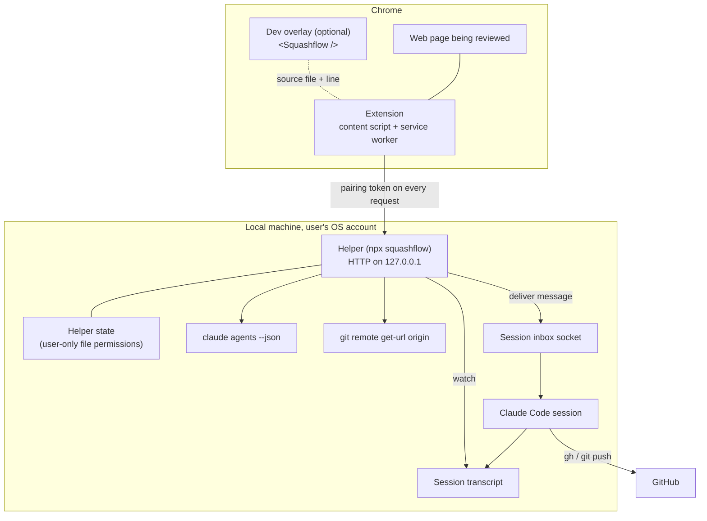

# Squashflow architecture

> **Partly implemented.** The local helper (build step 1) is implemented in [`packages/helper`](../packages/helper), and the extension's pins, page context and copy (build step 2), its pairing, session picker and sending (build step 3), its per-pin status and replies (build step 4), the GitHub flow's blocked-access options (build step 5), and region screenshots and the Web Store package (build step 6) in [`packages/extension`](../packages/extension), with the message builder, the GitHub flow's text contract and the helper's API schemas they share in [`packages/shared`](../packages/shared). The sections on the helper, pairing, discovery, the message, delivery and confirmation, the GitHub flow, the extension, sending, status, copy, region screenshots and packaging describe what the code does today. The dev overlay is still the planned design. When names, endpoints or formats change, this document is updated in the same pull request.

For a shorter overview, see the [README](../README.md). For the threat model and vulnerability reporting, see [SECURITY.md](../SECURITY.md).

## Goals and constraints

- **Local-first.** No Squashflow server. Everything except GitHub runs on the user's machine.
- **Use what the user already has.** The user's existing Claude Code session does the work, and the user's existing `gh` login does the GitHub work. Squashflow adds no accounts and stores no GitHub tokens or other third-party credentials; the only secret it keeps is the local pairing token.
- **The user stays in control.** Every outgoing message is shown before it is delivered, and Claude Code's own permission model is never bypassed.
- **Fail useful.** When delivery is impossible (no session, a site the user does not own, no push access), Squashflow falls back to something the user can still act on.

## Components



| Component | Responsibility |
| --- | --- |
| Extension | Pin placement (element, text selection, dragged area, multiple elements), page context capture, session picker, message preview, per-pin status and threads, local pin storage, copy fallback. |
| Helper | Pairing, session discovery, repository matching, message delivery, delivery confirmation, reply pickup, status events. |
| Claude Code session | Reads the pin, edits code, pushes a branch, opens a pull request, replies. |
| GitHub | Hosts the branch and pull request, reached only through the session's `gh` and `git`. |
| Dev overlay | In the user's own React app on `localhost`, exposes the source file and line behind each element so the extension can include it in the pin. |

## The local helper

### Process and network

- Started with `npx squashflow` (or `squashflow start`). It runs in the foreground in a terminal so the user can see it and stop it with Ctrl+C. It is not published to npm yet; until then it runs from a clone (see the README). CI checks that `npx squashflow` works from the packed tarball (see [Packaging](#packaging)).
- Binds an HTTP server to `127.0.0.1` on port **47821** by default, changeable with `--port`. It refuses to bind anything else: not `0.0.0.0`, `::`, `localhost` or a LAN address.
- Has no outbound network access of its own beyond what `claude`, `git` and `gh` do when it runs them.
- Requires macOS or Linux. On Windows it prints that Windows is not supported yet and exits.

### Endpoints

All endpoints except pairing require the pairing token as `Authorization: Bearer <token>`. All responses are JSON except the event stream. Request bodies are capped at 64 KiB, except `POST /pins`, whose pins may carry [region screenshots](#region-screenshots): its cap is 16 MiB, enough for the most pins in one message (50) each with the largest screenshot.

| Method and path | Purpose |
| --- | --- |
| `POST /pair` | Exchange the pairing code shown in the terminal for a pairing token. Body: `{"code"}`. |
| `GET /health` | Report that the helper is running and paired, plus its version. |
| `GET /sessions` | List running Claude Code sessions: `pid`, `name`, `status`, `cwd`, the matched repository (`owner/repo`, or `null`), and what tells sessions apart: `title`, `branch`, `startedAt` and `lastActiveAt` (each `null` when unknown; see [Session identity](#session-identity)). |
| `POST /pins` | Preview, then deliver, one pin or a batch to a chosen session. See [Building the message](#building-the-message). |
| `GET /pins/{id}` | A delivered pin's record: `status` and `statusLabel`, Claude's replies as `thread`, `pullRequestUrl` once Fixed, `blocked` (`{"kind": "not-picked-up" \| "github-access", "reason"}`) while Blocked, `following` (whether the helper is still watching its transcript) and `revision`, which goes up with every change. `{id}` is the message's pin id; a batch is one message. Records are kept in memory, so a restarted helper answers `404`. |
| `POST /pins/{id}/follow-up` | Preview, then deliver, a follow-up to a pin that is Blocked: GitHub access, to the session that has it. Body: `{"action": "retry" \| "fork" \| "patch", "preview": true}`, then `{"action", "digest"}`. See [GitHub flow](#github-flow). |
| `GET /events` | Server-sent events stream (`event: pin`, the whole record as JSON) of every status change and reply, for the paired browser. Browsers' `EventSource` cannot send an `Authorization` header, so the extension reads it with a streaming `fetch`. |

### Request checks

Every request is checked in this order, and rejected on the first failure:

1. **Host.** The `Host` header must be exactly `127.0.0.1:<port>`. This defeats DNS rebinding, where a hostile domain is made to resolve to `127.0.0.1` but the browser still sends that domain in `Host`. Failure: `403`.
2. **Origin.** The `Origin` header, when present, must be the paired extension's `chrome-extension://<id>` origin; for `POST /pair` it must be some `chrome-extension://<32-letter id>` origin, which is then recorded. Requests from web page origins, or with no `Origin` on state-changing methods, are rejected. Failure: `403`.
3. **Size.** A declared `Content-Length` above the endpoint's cap (64 KiB, or 16 MiB for `POST /pins`) is rejected before anything is read, and a body without a declared length is cut off as soon as it passes the cap. Failure: `413`.
4. **Token.** The bearer token's SHA-256 is compared in constant time with the stored hash. Failure: `401`.
5. **Schema.** The body must be JSON and validate against the endpoint's schema. Every object is strict: unknown fields are rejected, at the top level and nested. Failure: `400`.

CORS responses name only the paired extension origin, never `*`.

## Pairing

1. On start, if there is no paired browser (or with `--pair`), the helper prints a pairing code in the terminal, such as `BGV9-7X3Y`. Pressing Enter in the helper's terminal prints a fresh code.
2. The user enters the code in the extension, which sends it to `POST /pair`.
3. The helper checks the code, then returns a random pairing token (32 bytes, base64url) and records the extension origin.
4. The extension keeps the token, with the helper's port, in the service worker's IndexedDB. That database belongs to the extension's own origin: web pages cannot read it, and neither can the pin mode script, which runs in the page's origin (unlike `chrome.storage.local`, which the pin mode script could read). Only the service worker calls the helper.

Pairing codes are 8 characters from an alphabet without look-alike characters, single-use, expire after **5 minutes**, and allow **5 attempts**; after that the code is void and a new one must be printed in the terminal. Re-pairing replaces the old token, which is how a user revokes a browser.

The helper stores only the SHA-256 hash of the token, with the paired origin, in `~/.squashflow/state.json` (or under `$SQUASHFLOW_HOME`). The directory is mode `0700` and the file `0600`.

## Session discovery and repository matching

1. The helper runs `claude agents --json`, which lists running sessions with `pid`, `cwd`, `name`, `status` (`idle` or `busy`) and `sessionId`.
2. For each folder it runs `git remote get-url origin` and normalises the result (SSH, `scp`-style, HTTPS or `git://`) to an `owner/repo` name. Remotes on other hosts keep the host, as `host/owner/repo`; anything else counts as no repository.
3. For the page being reviewed, the extension asks for sessions. Matching uses the repository a page is known to belong to. Today that is the site-to-repository mapping the user chose to remember for the page's origin; the dev overlay will report it directly for local apps once it exists. Repository names are compared case-insensitively.
4. If exactly one session matches, it is preselected. If several match, the user picks. If none match, or no repository is known for the site, nothing is selected and Send stays hidden until the user picks any session, or copies the pins instead. A session the user picked stays picked while it is running; a preselection is worked out again on every refresh, so it never outlives the match that made it.

Commands are run with `execFile` and fixed argument lists, never through a shell, with the session folder as the working directory and a timeout.

### Session identity

Several sessions often share a repository, so `GET /sessions` also reports what tells them apart, from sources the helper already reads:

- **`title`**: what the session is about. Claude Code writes its own title into the session transcript (`custom-title` after `/rename`, else `ai-title`, else a `summary`); the strongest kind wins, and within a kind the latest. With none, it is the start of the first prompt typed in the session, skipping peer messages (Squashflow's own pins), meta records, subagent records and Claude Code's wrapped command output. Only the transcript's first and last 256 KiB are read, so a long session costs the same as a short one, and nothing else from the transcript leaves the helper.
- **`branch`**: from `git symbolic-ref --short -q HEAD` in the session's folder; `null` when detached or when the name is not a plain branch name.
- **`startedAt`**: from `claude agents --json`.
- **`lastActiveAt`**: the transcript file's modification time.

All of it is untrusted text: control and line-separator characters become spaces, the title is one line of at most 80 characters (cut with `…`), and the branch at most 100. The extension shows it as text only. The terminal tab or workspace a session runs in is not reported: finding it means asking a terminal multiplexer (tmux, herdr) or reading another process's environment, which is neither available everywhere nor safe to read.

## Building the message

A message delivered to a session has a fixed structure:

1. **Provenance header.** States that this is Squashflow pin `[sf-<12 hex>]` from the user's browser, delivered by the local helper, not typed in the terminal, with the page URL. Pins sent with `squashflow send` say so instead. It never claims to be typed by the user in the terminal or to come from anywhere else.
2. **The user's comment.** The only instructions in the message. Batches number the comments.
3. **Page context, fenced as data.** Selectors, element text, attributes, computed styles and source file and line (from the dev overlay), as JSON inside `<untrusted-page-context>` with a line telling Claude it is untrusted data and not to follow instructions in it. Every `<`, `>` and `&` in the JSON is escaped, so page content can never close the fence or the surrounding wrapper. Pins with a [region screenshot](#region-screenshots) add a second fenced section after it, `<untrusted-page-screenshots>`, naming each image file with its SHA-256 and telling Claude the images are untrusted page content too. The images themselves are never in the message.
4. **Requested outcome.** The [GitHub flow](#github-flow): fix the issue, create a new branch, commit, push and open a pull request with the user's own `git` and `gh`, and reply with a short summary and the pin's [fixed line](#the-fixed-line); if the push or the pull request fails for lack of access, do not retry, and reply with the pin's blocked line and a short summary instead.

The builder lives in `@squashflow/shared` and is used by both the helper (delivery) and the extension (copy), so both produce the same structure, fencing and escaping. A copied message states its provenance as copied from the user's browser and pasted by the user, and is filtered to the chosen [copy detail level](#fallbacks); a delivered message carries the context exactly as the extension sent it.

The previewed message is the delivered message:

1. `POST /pins` with `"preview": true` builds the message and returns it with its `pinId` and SHA-256 `digest`, without delivering anything.
2. The extension shows that exact message. To send it, it repeats the request with the `pinId` and `digest` instead of `preview`.
3. The helper rebuilds the message from the request and delivers it only if it hashes to the previewed digest, the preview is unused and less than 10 minutes old, and the session is the same. Otherwise the user must preview again.

`squashflow send` uses the same path: it prints the message, asks `Send this message? [y/N]`, and delivers only on `y`. It sends no screenshots.

## Region screenshots

Each new pin gets a screenshot of its region, cropped from the visible tab.

1. **Region.** The dragged area, or the box around the pinned element (or elements, or the element holding a text selection), with an 8 px margin, clipped to the viewport. A region with less than 4 px on screen gets no screenshot.
2. **Capture.** The pin mode script hides its whole UI (`visibility: hidden` on the overlay, panel and preview), waits two animation frames so the page repaints without it, and asks the service worker (`{"type": "screenshot", "region", "viewport"}`, validated against a strict schema). The service worker calls `chrome.tabs.captureVisibleTab` for the sender's window, only if the sender's tab is the active one. It needs no new permission: the `activeTab` grant from turning pin mode on covers it, until the tab navigates away. The full capture stays in the service worker; only the crop goes back.
3. **Crop and cap.** The region is mapped onto the captured image by the image's own size (which covers the device pixel ratio and page zoom), drawn on an `OffscreenCanvas` at most **1600 px** on its longest side, and encoded as PNG, then JPEG at quality 0.85 and 0.7, then the same again at 70 % of the size, until it is at most **200 KB**. If nothing fits above 64 px, or the capture fails, the pin is saved without a screenshot.
4. **Choice.** The comment box shows **Include screenshot**, ticked; unticking it saves the pin without one. A screenshot shows what is on screen, including the contents of form fields visible in the region, which page context never captures as text.
5. **Storage.** The screenshot is stored with its pin (see [Storage](#storage)) as `{"type": "image/png" | "image/jpeg", "data": <base64>, "width", "height"}`, validated on every read: base64 only, at most 200 KB of image data, sides at most 1600 px, and bytes that start with the PNG signature or the JPEG start marker for the declared type.

**Getting it to the session.** A screenshot travels with its pin in `POST /pins` (same schema, so the helper checks it the same way), and the helper writes it to a file the session can read with its own file tools:

- The file is `<state>/screenshots/<message pin id>/pin-<n>.png` (or `.jpg`), where `<state>` is `~/.squashflow` or `$SQUASHFLOW_HOME`. The folders are mode `0700` and checked to be real folders owned by the user, the file is `0600`. The helper removes message folders older than 7 days when it starts.
- The path depends only on the message's pin id and the pin's number, so the preview already names it. The message line is `- Pin <n>, PNG <w>×<h> px: read the image file <path> (SHA-256 <hex>)`. Because the hash is part of the previewed message, its digest covers the image: a send whose image differs from the preview's no longer hashes to the digest and is refused, so the image delivered is the one the user confirmed.
- The helper writes the files just before it writes the message to the inbox socket, so they exist when the session reads the message.

Why a file: the inbox socket carries one text message in an undocumented format, so an image cannot ride along safely; Claude Code reads image files with its own tools, under its own permissions; and a user-only file under the helper's state keeps the image on the machine and out of the repository. The cost is that a session asking to read a file outside its project may ask the user for permission first.

## Delivery and confirmation

1. The helper wraps the message as `<cross-session-message from="uds:<helper socket>" from-name="squashflow">…</cross-session-message>` and writes it as one NDJSON line, `{"type":"user","message":{"role":"user","content":…}}`, to the session's inbox socket at `/tmp/cc-socks/<pid>.sock` (`$SQUASHFLOW_INBOX_SOCKET_DIR` overrides the folder, which the browser test uses to deliver to a fake inbox). The helper socket named in `from` is a real socket it listens on, `/tmp/squashflow-<uid>/helper-<pid>.sock` (a short per-user path, so it never contains spaces). The session shows it as "Message from @squashflow" and treats it as a request from another session, never as the user's own typing; Claude Code's permissions still apply.
2. Before writing, the helper checks the inbox path with `lstat` and refuses anything that is not a socket, is not owned by the current user, or is not mode `0600`. A symlink is refused, not followed. `--bare` sessions have no inbox socket and cannot receive pins.
3. The pin moves to **Sent**.
4. The socket sends no acknowledgement, so the helper watches the session's transcript, `<config>/projects/<cwd with every non-alphanumeric character as ->/<sessionId>.jsonl`, where `<config>` is `$CLAUDE_CONFIG_DIR` or `~/.claude`. It reads only lines appended after delivery and matches them on the pin id. It keeps watching until Claude's reply (point 8), or until the transcript has had no new lines for 30 minutes (for example when the session exited or the held message was rejected). The 30 minutes restart with every new line, so a long piece of work in a busy session is still followed; a pin still Sent or Approve in terminal when they run out moves to **Blocked** (`Blocked: not picked up`).
5. When a `user` record with a peer origin carrying the pin id appears, the pin moves to **Seen by Claude**.
6. If Claude Code is holding the message for approval (a session in bypass-permissions mode records a "Held peer message" notice), the pin moves to **Approve in terminal** until the user approves it there, then to **Seen by Claude**.
7. If the session is busy, Claude Code queues the message and handles it between steps; the pin stays **Sent** until it appears in the transcript.
8. When Claude replies, the helper picks the reply out of the transcript and sends it to the extension as a thread message. The reply is the text of Claude's last assistant message in the turn that handled the pin: the turn starts at the peer record carrying the pin id and ends at Claude Code's `turn_duration` notice, or at the next prompt typed in the session. Only text parts count (no thinking, tool calls or images), subagent (sidechain) records and lines over 1 MiB are skipped, control characters are dropped, and the text is capped at 8000 characters (a longer reply is cut and marked as cut). A reply that carries the pin's [blocked line](#github-flow) moves the pin to **Blocked: GitHub access** with the session's reason, even if it also mentions a pull request. Otherwise, a reply that carries the pin's [fixed line](#the-fixed-line) for a pull request on the session's repository moves the pin to **Fixed** with that link; with neither, the pin stays Seen by Claude with the reply on its thread. A pull request link anywhere else in the reply never makes a pin Fixed. A batch is one message with one pin id, so its reply belongs to every pin in the batch. The reply is untrusted text: the extension renders a safe subset of markdown from it as DOM nodes and never parses it as HTML (see [Pin status and replies](#pin-status-and-replies)).
9. The user marks the pin **Resolved**, typically after merging, and can reopen it. Resolved is kept by the extension only; the helper's status underneath is unchanged.

```text
Draft ──> Sent ──> Seen by Claude ──> Fixed (reply + PR link) ──> Resolved
                │
                ├──> Approve in terminal
                └──> Blocked (not picked up)
Seen by Claude ──> Blocked: GitHub access ──(follow-up)──> Sent ──> …
```

## GitHub flow

The session creates a branch, commits, pushes and opens a pull request with the user's own `gh` login and git credentials. Squashflow never sees or stores a GitHub token, and the helper runs no `git` or `gh` command for this flow: all of it is the session's work, under Claude Code's own permissions. The text contract with the session lives in `@squashflow/shared` (`github.ts`), so delivered and copied messages ask for the same thing.

### The fixed line

The message asks the session, once the pull request is open, to put this line on its own, outside any code block, and to leave it out if it did not fix the pin (for example, the pin reached a session on another repository):

```text
SQUASHFLOW-FIXED [sf-<12 hex>] https://github.com/<owner>/<repo>/pull/<n>
```

The helper moves the pin to **Fixed** with that link only when the line names this message's pin id, starts its own line exactly, is outside fenced code blocks, carries a GitHub pull request link and nothing else (a trailing `.` or `)` is allowed), and the link's `owner/repo` is the repository of the session the pin went to (ignoring case). A session with no known repository can never mark a pin Fixed. The last line that qualifies wins. Retry and fork follow-ups ask for the same line. Before this line existed, any pull request link in a reply made the pin Fixed, so a reply saying the pin had landed by mistake, which named an unrelated pull request, showed the pin as Fixed; requiring the line closes that.

### The blocked line

If the push or the pull request fails because the user lacks access, the message asks the session not to retry or work around it, to keep the commit on its branch, and to reply with this line, on its own, followed by a short summary of the change:

```text
SQUASHFLOW-BLOCKED [sf-<12 hex>] github-access: <one-line reason>
```

The id is the message's pin id (a batch's single id). The helper looks for the line in the reply it picked out of the transcript and moves the pin to **Blocked: GitHub access** with the reason (control characters dropped, at most 300 characters). Claude's reply is still untrusted text, so the line counts only when:

- it names this message's pin id. The id is random and created when the message is previewed, after the page context was captured, so page content quoted in a reply cannot carry it; anything that knows it has read the delivered message, which is no more than the session itself could write;
- it starts its own line, exactly: a line that is quoted (`>`), indented or prefixed does not count, and page context is JSON inside its fence, so page text never starts a line of the message;
- it is outside fenced code blocks (`` ``` `` or `~~~`);
- the reason is present and is not the instructions' own `<one-line reason>` placeholder.

When several lines qualify, the last one wins. The blocked line wins over a fixed line in the same reply, and a blocked reply never sets the pin's pull request link.

### The four options

The extension shows the session's reason and four options under a pin that is Blocked: GitHub access:

- **Log in:** shows "Run `gh auth login` in a terminal, then press Retry." **Retry** sends the `retry` follow-up: push the branch again and open the pull request.
- **Fork and open a PR:** sends the `fork` follow-up: fork with `gh repo fork --remote --remote-name squashflow-fork`, push the branch to the fork, and open the pull request from the fork against the original repository.
- **Copy the patch:** copies the diff from the most recent reply that has one: the last fenced block marked `diff` or `patch` that reads as a unified diff, from a reply that was not cut. When no reply has one, it sends the `patch` follow-up instead, asking the session to reply with the change as one unified diff in a `diff` block and not to push; the user presses Copy the patch again once Claude replies. A reply to the patch request that reports neither a pull request nor a new block returns the pin to the block it was in.
- **Ask the owner:** copies a ready-made message for the repository owner, built in the extension from the page URL, the pin's comment and Claude's summary (the reply that reported the block, without the blocked line or code blocks, capped at 2000 characters), saying the user lacks access and offering the patch when one is available.

The patch comes from the session rather than from the helper running `git diff` in the session's folder. The session knows which branch and base the change is on, while the helper would have to guess a base (`origin/HEAD` may be missing, the folder may have moved on to other work), and running `git` there for content means trusting the repository's own configuration (diff drivers, `core.fsmonitor`). Asking the session keeps the helper's commands to the fixed discovery calls it already makes. The cost is that a patch longer than the reply cap (8000 characters) is cut, and a cut reply yields no patch; the panel then has nothing to copy, and the user can ask the session in the terminal to write the patch to a file.

### Follow-ups

A follow-up is fixed text per action (`buildFollowUp`): a provenance header naming the pin id (so the transcript watch recognises it), the request, and, for `retry` and `fork`, the same blocked-line instructions as the first message. Nothing from the page or the reply goes into it.

1. **Preview, then send.** The panel asks the service worker (`follow-up-preview`, with the extension's own pin id and the action); the service worker finds the helper's message id for that pin and calls `POST /pins/{id}/follow-up` with `"preview": true` and the stored token. The helper answers only for a pin that is Blocked: GitHub access and no longer followed, and returns the exact message and its digest, which the panel shows in the same preview dialog as pins. Only **Send to claude@`<name>`** delivers it (`follow-up-send`, then the request with the `digest`); Cancel or Escape sends nothing.
2. **Same session.** The helper delivers it only to the session the pin first went to, matched by pid and session id; if that session is gone, it refuses.
3. **Following again.** Delivery writes to the inbox socket exactly as for a pin, moves the pin to **Sent** with no block, and follows the transcript again from there: Seen by Claude, then Fixed, Blocked: GitHub access again, or back to the earlier block after a patch reply.

The pin mode script never sees the pairing token: as for every other helper call, the service worker makes the request and answers with the previewed message or the pin's record.

## The extension

A Manifest V3 Chrome extension built with Plasmo, in TypeScript.

### Permissions and injection

The manifest asks for `activeTab`, `scripting`, `storage` and `unlimitedStorage`, and nothing else: no host permissions, no declared content scripts, no remote code. `unlimitedStorage` lifts `chrome.storage.local`'s 10 MB quota, which region screenshots (up to 200 KB each, 50 pins per page) would otherwise reach after a few dozen pins; it shows no install warning. Calls to the helper need no host permission either: the service worker's requests to `http://127.0.0.1:<port>` are cross-origin requests carrying the extension's `chrome-extension://<id>` origin, which the helper answers with CORS headers naming that origin only. Clicking the toolbar button (or the `Alt+Shift+P` shortcut, which triggers the same action) grants `activeTab` for that tab, and the service worker injects the pin mode script into it with `chrome.scripting.executeScript`. Pages other than `http` and `https`, and pages the browser protects, are refused with a badge on the button. Each injection toggles pin mode: the script's isolated world keeps the running instance between injections on the same page.

### Pin mode

While pin mode is on, the extension listens in the capture phase and stops the page from seeing clicks, so the page does not react:

| Pin | How |
| --- | --- |
| Element | Click it. |
| Dragged area | Press and drag more than 6 px. The pin records the area, the elements wholly inside it, and the deepest element enclosing them. |
| Several elements | Shift+click each one, then release Shift. |
| Text selection | Switch the panel to Text and select text. The pin records the selected text and the element holding it. |

A new pin opens a comment box; the pin is saved only when the comment is. Each pin gets a numbered marker, placed on its element if the selector still finds it and otherwise where it was captured. Escape closes the comment box or the message preview, then clears a Shift selection, then leaves pin mode.

All of the UI lives in a shadow root on a `<squashflow-root>` element appended to `<html>`. Its styles live inside the shadow root, so they never reach the page, and `all: initial !important` on the host stops inherited page styles, including a page's `!important` rules, from reaching in. Keys typed in the UI are stopped at the host so they do not trigger the page's own shortcuts. The page's scripts can still observe input to in-page UI, so comments are not secret from the page.

### Page context

Each pin captures context at the Detailed level, validated against the shared `pageContextSchema` (the same schema the helper checks request bodies with):

| Field | Contents |
| --- | --- |
| `kind` | `element`, `elements`, `text` or `area`. |
| `selector` | A selector that matches only this element: a stable id, else a test id (`data-testid`, `data-test`, `data-cy`, `data-qa`), `name` or `aria-label`, else a short path of tags and stable class names anchored on the nearest such ancestor, with `:nth-of-type` only where needed. Ids and classes that look generated (CSS-in-JS, CSS modules, framework ids, long digit runs) are skipped. |
| `text` | The element's text, whitespace collapsed, without script, style or form field text. Capped at 300 characters. |
| `attributes` | Up to 20 attributes, each value capped at 200 characters. |
| `styles` | 25 computed style properties (layout, box, colour, type, flex and grid), leaving out values that only restate a default. |
| `structure` | An indented outline of up to 3 ancestors, 3 siblings on each side and 6 children, as tags, ids, stable classes and roles only. Capped at 1500 characters. |
| `rect`, `area` | Boxes in page coordinates. |
| `selectedText` | For text pins, capped at 1000 characters. |
| `elements` | For multi-element and area pins, up to 20 more elements, each captured like the first. |
| `viewport` | Width, height, scroll position and device pixel ratio. |

Never captured: the value of any form field, typed or default (the `value` attribute and the text of `input`, `textarea`, `select` and `option`, including password and hidden inputs), inline event handler attributes (`on*`), `nonce`, `integrity` and `srcdoc`. Nothing from inside the pin UI is captured.

### Storage

Pins are kept in `chrome.storage.local`, which web pages cannot read, under one key per page, `pins:<origin><path>`; query strings and fragments share the page's pins. Each stored pin has its id (`sf-<12 hex>`), comment, context, region screenshot when it has one, page URL (without the fragment) and timestamps. A page holds at most 50 pins, the most the helper accepts in one message. Everything read back is validated, and entries that fail are dropped.

### Pairing, session picker and sending

The panel's **Send to Claude Code** section talks to the helper through the service worker: the pin mode script sends it a message (`chrome.runtime.sendMessage`), the service worker validates the request against a strict schema, makes the call with the stored token, and answers with the result or a failure in plain words. The pin mode script never sees the token. The helper's request and response shapes come from `@squashflow/shared`, the same schemas the helper validates with.

1. **Pairing.** The section shows **Not paired**, **Paired**, or **Helper not running** (checked with `GET /health` each time pin mode opens). **Pair with helper** asks for the code `npx squashflow` prints and the helper's port (47821 unless the helper was started with `--port`). A wrong, expired or locked code is explained and nothing is stored. **Re-pair** enters a new code, which replaces the token; **Forget** deletes it. A token the helper no longer accepts (for example after another browser paired) shows as Not paired.
2. **Session picker.** `GET /sessions` lists each session with its name, idle or busy status, title, repository and branch, when it started and was last active, and folder (see [Session identity](#session-identity)). Sessions on the repository remembered for this site come first, marked *this site*; when exactly one matches it is preselected, and otherwise nothing is selected until the user picks. With a session chosen, **Remember: this site's code is `owner/repo`** saves that mapping for the page's origin in `chrome.storage.local` (key `site-repos`, at most 500 sites); unticking it forgets the site. **Refresh** asks the helper again.
3. **Preview, then send.** **Send** on a pin, or **Send all**, calls `POST /pins` with `"preview": true` and shows the returned message, exactly as it will be delivered, in a dialog. Nothing is delivered until **Send to claude@`<name>`** is pressed; that repeats the request with the preview's `pinId` and `digest`. The panel then shows *Sent N pins to claude@`<name>`*, or the helper's refusal in plain words: the preview expired or no longer matches (preview again), the session is gone (refresh), the pins are too large, or the inbox socket was refused. Each sent pin then follows its status, as [below](#pin-status-and-replies).

When the helper is not running, not paired, or no session fits, the section says so and the Copy buttons stay available, so copy is always the fallback.

### Pin status and replies

The `send` request carries the extension's own ids of the pins in the message, so the service worker can map the helper's message id back to them.

1. **Storage.** The service worker keeps each sent pin's status, status label, thread, pull request link, Resolved mark, whether the helper is still following it, and the record's revision, in `chrome.storage.local` under one key, `pin-status`, by the extension's pin id (at most 500 pins; the least recently updated go first). It is the only writer, and applies changes one at a time; a record with a lower revision than the stored one is ignored, so a slow `GET /pins/{id}` never undoes a newer event. Everything read back is validated, including that a stored link is a GitHub pull request link. Deleting a pin forgets its status.
2. **Following.** While any pin is in flight (the helper's `following` flag), the service worker keeps `GET /events` open and applies each record to every pin delivered in that message; when nothing is in flight it closes the stream. Each time the stream opens, it re-reads `GET /pins/{id}` for the pins in flight, to catch up on anything published before. A Manifest V3 service worker is stopped when idle and loses its stream, so it also catches up whenever it starts, and the pin mode script asks it to (`track`) when pin mode opens and every 20 seconds while a pin on the page is in flight, which also keeps it running. A message the helper no longer knows (`404` after a restart) stops being followed, keeping the last status.
3. **Display.** The pin mode script reads the statuses and listens for changes to them. Each sent pin's marker is coloured by status and titled with it, and its row in the panel shows the status with a small Squish in the matching mood, Claude's latest reply, the pull request link (`PR #<n>`, opening in a new tab with `noopener noreferrer`) and **Resolve** or **Reopen**. The reply is rendered as a safe subset of markdown (`ui/markdown.ts`): paragraphs, headings shown bold, bullet and numbered lists, fenced code blocks, and inline bold, italics, code and links. It is built from DOM nodes and text nodes only, so no reply text is ever parsed as HTML; a link opens only when it is plain `https:` (no user name or password) and shows its own address, so a label cannot disguise where it goes; anything else stays text. Squish in the panel header follows the page's pins: blocked when one is Blocked or Approve in terminal, working while one is Seen by Claude, waiting while one is only Sent, squashed when the rest are Fixed; Resolved pins no longer count. After an action (copy, send, a failure) it shows that action's mood for a moment first.

Free-form follow-up messages on a pin's thread are not supported; the only follow-ups are the [GitHub flow's](#follow-ups) fixed ones for a pin that is Blocked: GitHub access.

### Copy

Copy builds the message with the shared builder, filtered to the chosen detail level, and writes it to the clipboard with the async clipboard API, falling back to `execCommand("copy")` on plain `http` pages where that API is missing. Copying one pin uses the pin's own id in the header; copying several uses a fresh id and numbers the comments.

At the Forensic level, the copied text names each pin's screenshot in the same fenced section as a delivered message, saying where it is instead of a file path:

- **One screenshot, on a page with the async clipboard** (`https`, or `http` on `localhost`): the text and the image (as PNG; a JPEG is redrawn) go on the clipboard as one item, and the text says so.
- **Several screenshots, or the clipboard refuses the image:** the text alone, saying that each pin's **Copy screenshot** button in the panel puts its image on the clipboard.
- **No async clipboard** (plain `http`): the text alone, saying the page cannot copy images and that sending the pin includes it.

## Fallbacks

| Situation | Behaviour |
| --- | --- |
| Helper not running or not paired | Copy-and-paste mode. Pins are saved locally in the browser. |
| No matching session | Copy-and-paste mode, or the user starts a session and refreshes the picker. |
| Site the user does not own | Copy-and-paste mode with detail levels: compact, standard, detailed, forensic. |
| Bypass-permissions session | Claude Code holds the message; pin shows **Approve in terminal**. |
| Several sessions on one repository | The user picks. |
| Busy session | Message is delivered and handled between steps. |
| No push access | **Blocked: GitHub access** with the options above. |

Copy detail levels. Each level adds to the one before; key attributes are `id`, `class`, `name`, `role`, `type`, `href`, `src`, `alt`, `title`, `placeholder`, `for`, `aria-label`, `aria-labelledby`, `data-testid`, `data-test` and `data-cy`.

| Level | Contents |
| --- | --- |
| Compact | Comment and element selectors. No page URL. |
| Standard | Adds the page URL, element text, selected text and key attributes. |
| Detailed | Adds computed styles, surrounding structure, positions, the viewport, the pin kind and the source location when available. |
| Forensic | Everything captured, including every captured attribute and the [region screenshot](#copy). |

## Dev overlay

`<Squashflow />` is an optional component for the user's own React app, rendered only in development. It maps DOM elements back to the source file and line that rendered them and makes that available to the extension on the page, so pins on a local app point Claude straight at the code. It does not hold the pairing token and does not talk to the helper directly. It is never meant to ship in a production build.

## Local data

- Helper state (pairing token hash, extension origin) is stored in `~/.squashflow/state.json`, readable and writable only by the user.
- Delivered pins' region screenshots are written to `~/.squashflow/screenshots/`, readable only by the user, and removed after 7 days (see [Region screenshots](#region-screenshots)).
- Pins, with their region screenshots, are stored in the extension's local storage, per page (see [Storage](#storage)), and sent pins' status and threads under one key (see [Pin status and replies](#pin-status-and-replies)).
- The pairing token and helper port are stored in the extension service worker's IndexedDB; remembered site-to-repository mappings in the extension's local storage.
- Nothing is sent to a Squashflow server, because there is none, and there is no telemetry.

## Packaging

### The extension

`pnpm --filter @squashflow/extension package` (or `pnpm package` at the root) runs a production `plasmo build`, then [`scripts/package.mjs`](../packages/extension/scripts/package.mjs) zips `build/chrome-mv3-prod` into `build/squashflow-<version>.zip` for the Chrome Web Store and prints its SHA-256.

- **One version.** The version lives only in `packages/extension/package.json`. Plasmo writes it into the manifest, and the script refuses to zip if the built manifest disagrees, or if the manifest sets `key` or `update_url`, which the Web Store sets itself.
- **Reproducible.** The zip writer ([`scripts/zip.mjs`](../packages/extension/scripts/zip.mjs)) sorts entries by path, fixes every timestamp at 1980-01-01, adds no extra fields and deflates at a fixed level, so the same build always gives the same zip. Source maps and symlinks are never packaged.
- **Icons.** Plasmo copies `assets/icon16.png`, `icon32.png`, `icon48.png`, `icon64.png` and `icon128.png` into the build. [`scripts/render-icons.ts`](../packages/extension/scripts/render-icons.ts) renders them from Squish's SVGs: a simplified Squish without the swatter for 16 and 32 px, the full one for the larger sizes, and the 128 px icon in the middle 96 px as the Web Store asks.
- **Listing.** The store text, permission justifications and privacy answers are in [`store/listing.md`](../packages/extension/store/listing.md), the privacy statement in [`store/privacy.md`](../packages/extension/store/privacy.md), and the screenshots in `store/screenshots/`, taken of the real extension on a local demo page by [`store/screenshots.spec.ts`](../packages/extension/store/screenshots.spec.ts) (`pnpm --filter @squashflow/extension store:screenshots`).
- **CI.** The `package` job builds the zip and uploads it as the `squashflow-extension` workflow artifact. Submitting it to the Web Store is a separate, manual step.

### The helper

The helper's build bundles its own code and `@squashflow/shared` into one file, `dist/cli.js`, with esbuild, leaving only `zod` as a dependency; `@squashflow/shared` stays a private workspace package and is never published. The helper's version is read from its `package.json` at build time. [`scripts/check-helper-pack.mjs`](../scripts/check-helper-pack.mjs) packs the helper with `pnpm pack`, checks the tarball depends on no workspace package, and runs `npx squashflow --version` and `--help` from it in an empty folder with an empty npm cache; the `package` CI job runs it. Nothing is published.

## Minimum Claude Code version

The helper needs Claude Code **2.1.224** or later: the first release with the session inbox socket and the `claude agents --json` fields above. The inbox wire format is not a documented public interface, so the minimum is pinned and `squashflow doctor` checks it, along with Node.js, `git`, `claude agents --json` and the inbox socket folder.

## Build order

1. Helper: list sessions, match repositories, send, confirm. (Done.)
2. Pins and page context in the browser, plus copy. (Done.)
3. Session picker. (Done.)
4. Claude replies and pin status. (Done.)
5. GitHub flow. (Done.)
6. Chrome extension packaging and region screenshots. (Done.)

## Open questions

None at the moment. Settled in build step 6: region screenshots are stored with their pins in the extension and passed to the session as user-only files the previewed message names by path and SHA-256 (see [Region screenshots](#region-screenshots)), and `@squashflow/shared` is bundled into the helper rather than published (see [Packaging](#packaging)).
